# Methods and scientific workflow

## Program structure

```mermaid
flowchart LR
  A[Original sources and inventory] --> K[Source requirements extraction]
  K --> R[Every requirement and proposal unit reviewed]
  R --> B[Context generation]
  B --> C[Schema and source-span checks]
  C --> D[Source-driven semantic review]
  D --> E[Locked compact context]
  E --> F[Backward workflow planning]
  F --> G[Input-output and branch checks]
  G --> H[Scientific review]
  H --> I[Candidate JSON and flowchart]
```

The generator receives a task-specific schema, preservation rules and an already reviewed source inventory. Separate reviews receive the complete source. Python checks structure, source spans, exact requirement/component/field coverage, request hashes, file contracts and graph consistency. The context reviewer receives extraction evidence and its locations. Reviews with unresolved judgments stop publication. All failures stop immediately; only a later explicit invocation may resume. This is not a trained compression model or a guarantee against semantic errors. See [the 3.9 algorithm and interfaces](RETENTION_ALGORITHM.md).

## References and the adaptations actually used

| Reference | Adaptation in this implementation |
|---|---|
| [Pritchard-Bell et al., 2026](https://pmc.ncbi.nlm.nih.gov/articles/PMC13442926/) | Explicit task instructions, domain rules, verification and file handoff |
| [RECOMP](https://arxiv.org/abs/2310.04408) | Question-conditioned relevance; trained compressors are not reproduced |
| [LLM-Modulo](https://arxiv.org/abs/2402.01817) | Candidate generation followed by external checks and feedback |
| [CWL specification](https://www.commonwl.org/v1.2/Workflow.html) | Explicit inputs/outputs and dependency graph; emitted JSON is not executable CWL |
| [FActScore](https://aclanthology.org/2023.emnlp-main.741/) | Motivation for checking distinct factual claims; its metric package is not called |
| [Summary of a Haystack](https://aclanthology.org/2024.emnlp-main.552/) | Motivation for source-driven coverage review; no published benchmark score is claimed |

These papers motivate components. None validates the complete software or the example's scientific conclusions. Version 3.9 additionally requires atomic-claim and decomposition reviews, because one context field can contain multiple facts. The model still chooses and judges those atoms; complete review records do not prove correct decomposition.

## Current animal-to-human research workflow

| Block | Purpose | Evidence basis and limit |
|---|---|---|
| B1 | Fix context, scope, literature and data gaps | Context-engineering and checked planning; no raw-data analysis |
| B2 | Prepare and QC available animal PK records | Confirm units, records, repeated sampling and provenance before fitting |
| B3 | Estimate supported animal compartmental PK | [PMB animal PK](https://pmc.ncbi.nlm.nih.gov/articles/PMC3486600/) is a starting example, not human translation validation |
| B4 | Evaluate species/design and parameter precision | [Ogungbenro & Aarons, 2008](https://pubmed.ncbi.nlm.nih.gov/18483725/): design depends on estimand, variation and sampling |
| B5 | Predict human PK with justified scaling comparators | [Sou et al., 2021](https://pmc.ncbi.nlm.nih.gov/articles/PMC8048880/); parameters cannot simply transfer to PMB or colistin |
| B6 | Review applicable PD evidence | Match drug, exposure definition, endpoint and experimental system |
| B7 | Link human exposure and drug response when supported | A conditional prediction, not verified clinical efficacy |
| B8 | Propagate uncertainty and freeze predictions | Separate parameter, scaling and structural uncertainty; fix evaluation criteria before looking at human outcomes |
| B9 | Compare with later independent human PK | [BWC0977](https://www.nature.com/articles/s41467-024-52557-2) illustrates animal-to-human PK comparison; good PK agreement does not establish PD validity |
| B10 | Answer questions with explicit limits and next-data priorities | Separate estimability, precision, model fit and external predictive accuracy |

This is a suggested workflow for the present problem. It is not a literal reconstruction of one paper, and additional methods are not attributed to the original proposal. Some branches remain blocked because no project animal observations, target specification or selected PD evidence were supplied.

The animal-model and human-prediction branches stay present when PD evidence is missing. Future human validation stays conditional and does not become a prerequisite for generating the initial prediction. Model selection must not use the held-out human observations. Historical methods calibrated using other drugs' human PK must be described honestly.

For species comparisons, [Tang et al., 2007](https://pubmed.ncbi.nlm.nih.gov/17646280/) and [Mahmood, 2009](https://pubmed.ncbi.nlm.nih.gov/19025899/) support evaluating applicability and disagreement rather than declaring a universal species minimum. Their methods and data must be matched before making a quantitative comparison.

## Model backend and literature retrieval

- The opt-in backend uses the installed Codex CLI with a JSON Schema and a dedicated final-response file, as documented in [OpenAI's non-interactive mode](https://learn.chatgpt.com/docs/non-interactive-mode). Authentication is delegated to the CLI; credentials are not opened by this program.
- The literature command sends an explicitly supplied public query to the [Europe PMC search service](https://www.ebi.ac.uk/europepmc/webservices/rest/search?query=DOI%3A10.1002%2Fcpt.2104&format=json). Search metadata and abstracts are not treated as inspected full text or verified datasets.
- The bundled library contains concise reviewed method summaries, source links, access depth and limits. Extending it is a separate evidence-review step, not automatic promotion of search results.

## What evaluation presently establishes

Automated tests check program behavior. The example uses saved responses authored by this assistant and internal review, with no blinded test set. Its review PASS therefore does not imply 100% extraction accuracy. Independent F/R/A scores remain null, and the final human decision is pending. No model fitting, animal experiment or clinical decision is performed here.
