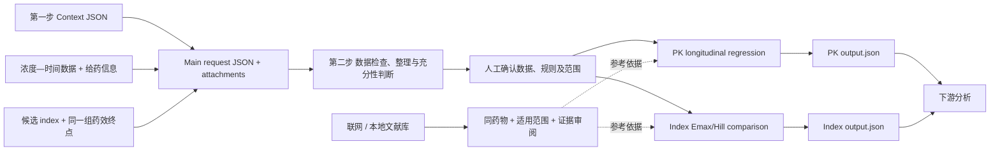

# 数据检查 → 人工确认 → PK 与 Index 并行 JSON 模块

## 本机前端

运行 `backend/research_pipeline/start-workbench.ps1`，打开 `http://127.0.0.1:8767`。已接入真实结果、数据预览、PK/index、模型与文献库、人工审核及 ZIP 重跑入口。详见 [工作台说明](docs/WORKBENCH.md)。

v0.2 新增 `data_preparation`，放在 Context Compression 之后、两个 R 分支之前。它输出数据错误、整理拆分候选、清洗日志和充分性判断；人工确认后才放行选中的数据集。**Index 比较不依赖 PK 分支拟合成功。** 上游压缩 JSON 的原有字段及 `NOT_FOUND` 保留。

2026-09-18：B1 新增全部附件读取、统一工作文件 ID、原始内容快照和可引用来源登记；B2 新增混合源表拆分及候选长表输出，再接现有科学 QC 和人工放行。详见 [输入输出、CLI 与 HTTP API](docs/ATTACHMENT_HANDOFF.md)。

新增入口：[待人工确认的判断方法](docs/DATA_PREPARATION_METHOD_FOR_REVIEW.md)、[数据模块 API 与输入输出](docs/DATA_PREPARATION_API.md)。

模型目录现可通过 `model_catalog_attachment` 与 `model_catalog_ids` 接入两个分支，绑定来源并核对实现范围。见 [模型目录接口与测试](docs/MODEL_CATALOG.md)。

实际 PMB 的 Emax/Hill 与大鼠 PK 审核脚本、输入输出及探索范围见 [探索性模型审核](docs/EXPLORATORY_MODEL_REVIEW.md)。

2026-09-19：正式 index 的游离指标候选池、主/探索分层与重新筛查入口见 [Index 重新筛查](docs/INDEX_RESCREEN.md)。



## 两部分分别需要什么

| 模块 | 必需数据 | 必需说明 | 主要 JSON 输出 |
|---|---|---|---|
| `data_preparation` | 原始数据附件、整理计划、规则来源 MD；可选精度规划依据 | 研究用途、字段/单位/分析物、采样层级及拟合配置 | 问题报告、候选表、隔离表、独立动物数、NOT_CALCULABLE 等判断、人工确认模板 |
| `pk_longitudinal` | 个体 ID、时间、浓度；剂量、给药时点、输注时长 | 药物、物种、基质、单位、total/free、记录层级 | CL/V 或 CL/Vc/Q/Vp、CI/RSE、拟合诊断、可移植模型参数及数据来源 |
| `pkpd_index`，`compare_indices` | 每个独立单位一行：ID、response、至少两个候选 index；可选 study/batch ID | 药效终点定义及单位；每个 index 的单位、暴露窗口、total/free | R²/AIC/AICc/ΔAIC 排名、各标准最佳候选、Emax/Hill 参数及 CI/RSE、分组 CV 误差、拟合图 |

Index 默认比较已经准备好的候选指标，例如 `fAUC_MIC_h`、`fCmax_MIC`、`fT_MIC_percent`。这些值可以来自独立的上游暴露计算，不要求来自本次 PK 拟合。还提供 `profile` 和 `from_pk` 暴露计算辅助模式；它们不是主流程的串行依赖。

## 本机直接运行

在工作区根目录 `du` 执行：

```powershell
.\backend\research_pipeline\run.ps1 --state outputs/data_review_demo run backend/research_pipeline/examples/preparation_parallel.request.json
```

主示例使用模拟数据，首次运行停在 `WAITING_FOR_REVIEW`，两个模型为 `SKIPPED`；这是预期的人工审阅流程。输出位于：

```text
outputs/data_review_demo/runs/preparation_synthetic_pending_001/
  request.json
  attachments.json
  attachments/
  steps/data/output.json
  steps/data/data_report.json
  steps/data/review_submission.template.json
  steps/pk/output.json
  steps/index/output.json
  output.json
```

按数据模块 API 文档提交真实人工决定，再以新 request_id 和 review 附件继续运行。原 run 保留；相同数据/规则/配置的确认可被读取，改变后旧确认失效。PK/index 确认后仍并行运行。

旧 `examples/parallel.request.json` 是保留的直接建模/软件验证示例，不包含新的审阅步骤；不能把它的运行成功当作数据已经获人工认可。每个 request_id 只能创建一次。上下游以 JSON 和 SHA-256 关联，不依赖 R 内存对象。

## Index 的拟合和选择规则

统一使用：`E = E0 ± Emax × I^h / (EC50^h + I^h)`。

- `estimate_hill: false`：固定 h=1，普通 Emax。
- `estimate_hill: true`：同时估计 h，sigmoid Emax/Hill。
- `direction` 指定 `decreasing` 或 `increasing`，所有候选保持一致。
- 各候选使用**完全相同的独立观测、响应尺度、暴露窗口、total/free 定义及误差模型**；缺测不能逐候选分别删除。
- `R2 = 1 - SSE/SST`，越大越好；AIC、AICc 越小越好。负 AIC 合法。
- 同 n、同参数数目、同方差独立高斯误差时，R² 与 AIC 都按 SSE 排序，两者一致不是独立验证。不同模型复杂度下可能不一致。[R 官方 AIC 文档](https://stat.ethz.ch/R-manual/R-devel/library/stats/html/AIC.html)
- 给出 `group_column` 后，按整组留出做 CV；任一折失败，汇总 CV 误差记为 null，保留失败原因。此模式要求至少三个组，这是当前接口设计要求，不能作为通用可靠性标准。
- 最佳候选表示当前数据和候选集合中的相对拟合表现。还要查看参数 CI、可辨识性、残差、暴露覆盖、指标相关性及独立数据预测。

当前误差模型为独立同方差高斯药效误差，不自动支持计数型似然、异方差、重复药效终点或联合 PK/PD 误差传播。重复终点不能换一个行 ID 伪装成独立样本。

## 文献库

```powershell
# 联网，只发送明确的查询和药物别名
.\backend\research_pipeline\run.ps1 search --provider online --query '(pharmacokinetic OR pharmacodynamic) AND model' --drug 'polymyxin b' --limit 10 --out outputs/pmb_search.json

# 将本地 PDF、TXT、MD 或模型卡 JSON 建入库
.\backend\research_pipeline\run.ps1 index path/to/paper.pdf backend/research_pipeline/examples/roberts_reference_inventory.json

# 本地检索不联网
.\backend\research_pipeline\run.ps1 search --provider local --query 'clearance model' --drug 'polymyxin b' --out outputs/local_pmb_search.json
```

联网使用 Europe PMC；本地使用 SQLite FTS5，返回文件 SHA、页码/字符位置、摘要片段及文件是否已变动。搜索命中不自动取得模型认可。PMB、colistin、CMS、FADDI-365 分别处理；同药物只是第一层条件。

`reference_mode: baseline` 可运行探索性拟合；`paper_guided` 要求来源文件绑定的已审阅模型卡及范围匹配。该模式检查已记录的依据，不自动复刻论文代码或证明外部预测有效。详见 [参考文献规则](docs/REFERENCE_POLICY.md)。

## API

```powershell
.\backend\research_pipeline\run.ps1 --state outputs/research_pipeline_api serve --port 8765
```

启动后访问 `http://127.0.0.1:8765/docs`。先上传附件取得 `upload_id`，再向 `POST /v1/runs` 提交 JSON。两个模块也可分别通过 `/v1/modules/pk_longitudinal/run` 和 `/v1/modules/pkpd_index/run` 调用。

服务默认只监听本机；可选环境变量 `RESEARCH_PIPELINE_API_TOKEN` 设置 Bearer token。API 使用上传 ID，CLI 可以使用明确的本地路径。详见 [API 说明](docs/API.md)、[数据契约](docs/CONTRACTS.md)。

## Roberts Fig.4b

`examples/roberts_pmb.request.json` 使用本机原始 Excel 的 PMB 数据：11 只大鼠、102 个定量浓度。显式排除的 8 条非定量/未采样记录保存在 JSON 中；排除 BLQ 会产生偏倚风险，当前尚未实现删失似然。

该图没有完成指标比较所需的药效终点和候选 index。因此，这个文件可进入 PK 分支；**不能由 Fig.4b 单独得出 PMB 的最佳 PK/PD index**。当前房室模型为探索性模型；论文中的 NCA 不能被视为对该房室模型的验证。

## 安装与测试

依赖已安装在本机 `.venv-context`；R 使用 `ScienceEnv/R`。另一台电脑保留 `research_pipeline/`、`pkpd_r/`、`context_compression/schemas/` 的相邻布局，运行 `setup.ps1`，并设置 `PKPD_RSCRIPT` 指向 Rscript。R 包需 `jsonlite`、`minpack.lm`、`nlme`。

```powershell
.\.venv-context\Scripts\python.exe -I -m pytest backend/research_pipeline/tests -q
& 'C:/Users/georg/Documents/Codex/ScienceEnv/R/bin/Rscript.exe' --vanilla pkpd_r/tests/run_tests.R
```

真实 Roberts 测试需要本机源文件，缺少时明确跳过。模拟数据验证软件计算；不构成 PMB 科学模型验证。
