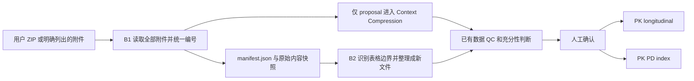

# 第一阶段读取附件 第二阶段整理数据

## 当前接口：3.11.0

**下游只接收一个 `handoff/main.json`，其中科研任务、药物信息等 3.0 字段已实际提取，附件在 data.files。** B2 直接读取该 JSON 及其原始附件，不再要求另外传 compressed_context、file_handoff 或 intake manifest。规则编号 R001…；主文件不含 handoff_sha256。提取/审查未完成时没有 main.json。详见 [单 JSON 接口](../../context_compression/docs/SINGLE_JSON_HANDOFF.md)。

以下 manifest、快照和旧 file_handoff 描述是内部记录及旧版接口的技术说明，不是当前面向下游的交付清单。

## 分工



B1 读取全部明确提交的文件，不沿文档或 inventory 中的任意本机路径继续搜读文件。支持 DOCX、PDF、MD、TXT、XLSX、CSV、JSON 和包含这些类型的 ZIP；遇到不支持、不可读或超过限制的文件会报错，不静默跳过。

第一步对工作副本重新命名为 `F0001.xlsx` 等名称，不改用户原文件，也不在这里把混合表拆成科学数据集。编号对相同输入和排序保持一致；文件增删后可改变，所以跨批次身份必须同时使用原文件名与 SHA-256。所有表格内容进入带坐标的快照；空格、重复列名、缺失标记、公式及其缓存状态都保留，留待第二步处理。

Context 模型仅收到唯一选定 proposal 的正文和审查材料。附件数据、README、模型目录不进入压缩；完整内容保留本地，`file_handoff.json` 提供文件检查与分配结果。`inventory.description` 留给可选的流程规划使用，不能作为 proposal 的原文证据。声明存在、读取完成、数据 QC 通过和可用于拟合是四种不同状态。

文件分配：数据表 → `data_preparation`；含 `model_id` 表头的 CSV 目录 → `literature_search`；说明文件 → 第二步查阅；benchmark/holdout → `validation` 专用。B1 不根据文件名猜 PK/index 数据充分性；科学拆表和最终分支分配交给 B2。proposal 中声明的数据与附件实际内容是否一致，也留给 B2 判断。

名称包含 benchmark/holdout 或通过 `--reference-only` 指定的文件仍会读取、解析、登记，但其数值内容留在参考快照中，不发送给主要 Context 模型或进入 B2 拟合候选。文件类型与用途可以在清单中追溯。

## B1 输入与输出

```powershell
& '.\.venv-context\Scripts\python.exe' -I -m ctxcomp.cli init `
  --package 'C:\Research\PMB_Agent_Ready_Package.zip' --out 'C:\Research\new_run'

# 或明确列出文件。inventory 声明本身不会触发读取其 path。
& '.\.venv-context\Scripts\python.exe' -I -m ctxcomp.cli init `
  --proposal 'C:\Research\proposal.docx' `
  --attachment 'C:\Research\observations.xlsx' --attachment 'C:\Research\catalog.csv' `
  --out 'C:\Research\new_run'
```

| 输出 | 内容 |
|---|---|
| `intake/manifest.json` | 文件 ID、原名、新名、用途、读取状态、快照路径及哈希 |
| `intake/files/F0001.*` | 重新命名的原文件副本，字节内容不变 |
| `intake/parsed/F0001.json` | 完整读取快照，尚未清洗 |
| `intake/source_registry.json` | 本地保存的来源 ID 和原文，不直接发送给压缩模型 |
| `intake/compression_sources.json` | 压缩模型唯一可用的 proposal 来源；全量 source_registry 留本地 |
| `intake/source_text/*.json` | 分页内容，包括留在本地的参考文件内容 |
| `inputs.json` | 绑定附件清单、来源、策略和长度预算的 Context 输入 |
| `file_handoff.json` | 全文件的用途、接收模块、路径、哈希与 context 引用；审核前 `FILES_CHECKED_CONTEXT_PENDING`，通过后 `READY_FOR_DATA_PREPARATION` |

后续 `prepare / run / accept` 仍使用原接口。`init` 成功只表示完成读取和输入冻结；它不意味着大模型已经生成或审查了压缩结果。新来源和新 schema 必须使用新请求，不能改旧请求哈希来复用未经重新绑定的响应。

## B2 输入与输出

```powershell
& '.\.venv-context\Scripts\python.exe' -I -m research_pipeline `
  prepare-sources 'C:\Research\new_run\intake\manifest.json' `
  --out 'C:\Research\new_run\source_preparation'
```

B2 先核对 B1 清单与原始文件、解析快照的哈希。边界支持 Excel 已命名表、明确的“标题 + 来源 DOI”段落，或显式 JSON 拆表计划；不会仅按空白行猜测。未知布局、重叠范围或含糊表头会停止当前运行。可以通过 `--plan plan.json` 提供明确范围：

整条流程推荐把同一命令的输入改为 `new_run/file_handoff.json`：程序先验证 proposal 审查、context 哈希和文件分配，随后解析其 `intake_manifest.path`。尚未审查完成时返回 `CONTEXT_NOT_READY` 并停止。直接使用旧的 intake manifest 接口仍可独立整理附件，但不会声称 proposal 审查已完成。两种入口均不放行拟合；模型目录路由到检索，不转换成观测数据。

```json
{
  "F0002:Source tables": [
    {"range": "A25:L40", "header_row": 30, "title": "Rat plasma PK"}
  ]
}
```

每张表输出：

- `tables/T0001.source.json`：原表区域、标题、注释和原始单元格。
- `tables/T0001.records.json`：候选新数据表及逐记录来源。已识别的动物浓度宽表和终末药效宽表转换成长表；其他表保留逐行字段和表头映射。
- `unassigned/*.json`：落在表格区域外的内容，不静默删除。
- `output.json`：所有新文件、来源与输出哈希、状态、缺失/非定量计数和下一步接口说明。

空槽位、BLQ、未采样、导管故障、点号缺失各自保留，不补零、不当作独立动物。列标签只产生候选身份；`subject_id` 在独立性核实前仍为 `NOT_FOUND`。组汇总不拆成伪个体，AUC/Cmax 汇总不造浓度曲线。这里只做结构整理，尚未自动完成剂量、途径、单位、个体身份和可辨识性审阅。

候选 JSON 使用 `{records: [...]}`，可作为已有 `data_preparation` 的 `data_attachment`。为每个选中数据集补齐有来源的 metadata、analysis_options 和必要 column_map 后，走已有的数据 QC、充分性判断和人工放行接口。原始文件 ID、哈希、行号和字段单元格会继续进入 QC 的 `_source`。

`WAITING_FOR_REVIEW` 是整理完成后的正常暂停状态，不是自动允许拟合。PK 与 index 保持平行；没有匹配的候选 index 与终点，不能只靠 time-kill 或终末 CFU 自动选出最佳 index。

新候选表标记 `fit_ready: false`。若直接传给 PK/index 接口，程序返回 `SOURCE_REVIEW_REQUIRED`，要求先经过已有的数据 QC 与人工放行流程。

## HTTP API

1. `POST /v1/attachments` 上传 ZIP，取得 `upload_id`。
2. `POST /v1/intakes`：`{"package_upload_id":"…","reference_only":[]}`，返回 `intake_id` 和读取清单；不调用大模型。
3. `POST /v1/data-preparation/source-tables`：`{"intake_id":"…","table_plan":{}}`，返回拆表状态与 `source_preparation_id`。
4. `GET /v1/source-preparations/{id}/files/tables/T0001.records.json` 下载候选表。
5. 用既有 `/v1/modules/data_preparation/run` 完成科学 QC，之后通过既有 review 接口放行选中的数据集。

HTTP 只接受服务器已登记的上传或 intake ID，不接受调用方任意指定服务器本机路径。CLI 和 Python 函数使用明确的 JSON 文件接口。
