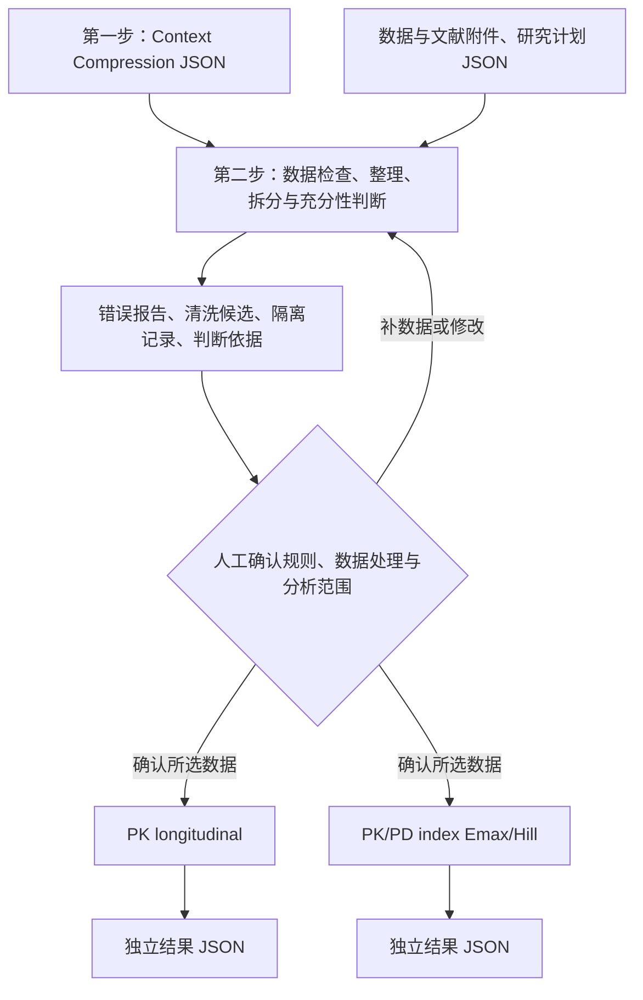

# 数据整理与充分性判断方法——待人工确认

版本：`2026-09-16.1`；状态：**PROPOSED_PENDING_HUMAN_CONFIRMATION**。

依据：[用户指定的 species_selection_evidence.md](C:/Users/georg/Documents/Codex/2026-09-15/file-c-users-georg-downloads-s11095/cms_translational/species_selection_evidence.md)。已完整读取本地文件，保留原文件；项目内保存原文快照和 SHA-256。规则为该文档的可执行解释，不是最低动物数法规，也没有把文档附录的 CMS 专属结构直接套在 PMB 上。

## 位置与流程

PK 和 index 仍是平行分支。人工可分别确认要放行的数据集。第一步的 compact context 结构与 NOT_FOUND 规则不变。

## 一、数据质量与整理

| 判断项 | 自动处理/输出 | 人工需要处理的部分 |
|---|---|---|
| 来源与原始记录 | 附件快照、SHA、原始表、原单元格或行号 | 核对提取与原文一致 |
| 列名、空白、数值字符串 | 按明确 column_map 映射；去首尾空白；严格数值解析；记录前后值 | 确认字段含义和映射 |
| 单位 | 明确单位下转换 min/s→h、ng/mL→mg/L、µg/mL→mg/L 等；保留原单位与转换系数 | 未声明或不支持的单位必须补充；mg/kg 不无体重转换成 mg |
| 不同数据定义 | 按药物、分析物、物种、途径、基质、total/free、制剂、参数定义、单位和记录层级拆分 | 确认这些分组科学上可比；不把不同名称自动认作不同真实物种 |
| 完全重复 | 生成去重候选，重复行保存在隔离表 | 明确确认去重；冲突重复值不得自动平均 |
| 缺测/BLQ | 隔离标记为 BLQ、未采样、导管堵塞的记录；不填 0、LLOQ/2 或猜测 LLOQ | 确认排除的分析范围和偏倚；需要删失模型时先补模型 |
| 错误值 | 无效数字、负浓度、缺少 ID、单位不明、重复药效终点等逐项报错 | 修改来源/映射/模型，再评估；不能用“确认”跳过硬错误 |
| 异常高低值 | 保留；不按全局 IQR 自动删除 PK 峰浓度 | 结合采样时间、分析记录与模型残差检查，目前未实现自动统计离群判定 |

清洗始终生成**候选副本**。原始数据不覆盖。处理器不自动猜测给药、MIC、fu、个体体重或浓度缺失值。

## 二、把“数据不足”分为三个层次

### A. 当前模型无法运行：BLOCKED

例如缺少必需浓度/剂量、冲突重复记录、将组均值当个体、用终末采样假装每只动物完整曲线，或 Emax 数据没有响应变化。

代码还检查当前模型实现的残差自由度和暴露水平条件：这些是**计算可运行条件**。一室/二室参数数目和 Emax/Hill 的自由参数数目会改变它们；它们不是文献规定的“每种动物最少几只”，也不证明参数可辨识。

### B. 能尝试拟合，但无法判断正式精度：NOT_CALCULABLE / REVIEW

- 独立 n 按动物 ID 计数；同一动物多次采样不增加 n。跨实验重用 ID 时，应先明确独立单位和唯一 ID。
- 个体 CL/其他关键参数，或文档可反算的 SD/SE/CI、已明确指数随机效应定义的 IIV，可提供规划变异。
- residual error、检测 CV、某时间点浓度 SD、TVCL 的 RSE/SE、体外技术重复 SD，不能代替动物间参数变异。
- 缺合格变异、预先指定的精度倍数 M、置信水平或宽度保证概率 A 时，不输出唯一正式 n。
- 稀疏/终末采样的样本量、多个物种/参数联合成功概率，需要另外的模拟—重估；当前不冒充已经实现。

当前计算器仅支持独立个体参数近似 lognormal 的**条件性**几何均值 CI 宽度规划。设已有文档支持的 log 尺度 SD 为 σ，预设半宽 ln(M)，计算：

`h = t_(1-alpha/2,n-1) × s / sqrt(n)`

`P(h ≤ ln M) = F_chi-square(n-1)[(n-1)n(ln M)² / (t²σ²)]`

逐个 n 找到首个达到 A 的值。该概率条件于输入 σ；没有把先导方差估计误差或未知模型结构自动积分进去。应做敏感性分析或模拟。t 区间依据见 [NIST](https://www.itl.nist.gov/div898/handbook/eda/section3/eda352.htm)，分布实现使用 SciPy；测试与 R 的 qt/pchisq 独立核对。

### C. 人体外推的数据充分性：单独报告

| 情况 | 本规则给出的判断 |
|---|---|
| 未知体重指数，少于 2 个可比物种 | 不能从本药数据识别斜率 |
| 2 个可比物种 | 可以定直线，但无物种间残差自由度；尚未达到文档的三物种探索起点 |
| 3 个可比物种 | 仅 1 个物种间残差自由度，标记 EXPLORATORY_ONLY，仍需审阅 |
| 外部已固定指数 | 要明确指数及依据，可作条件性情景；不能声称估出了本药斜率 |
| 没有体重信息/无体重跨度 | 不能确认体重回归可识别；不自行规定一个通用“足够跨度”阈值 |
| CL/F、CL_col/f_m、按 kg 归一化 CL | 明确标记定义差异；不能当作绝对 CL 直接套指数 |
| 血浆、ELF、痰液或前药/活性药混用 | 拆分并人工检查部位/形成过程可识别性；多物种血浆不能替代部位信息 |
| 无独立人体观测 | 始终不标为已验证人体预测；本 block 只做可用数据审计，不执行 allometry 或人体预测 |

“3 物种”来自该文档的项目探索约定。统计比较研究并未支持一条通用的“物种越多必然越可靠”规则。

## 三、人工确认的具体内容

人工需同时明确：

1. 接受本版判断规则及其来源；或提出修改。
2. 哪些拆分后的数据集可进入哪个模型分支。
3. 接受哪些清洗、重复行/BLQ 隔离建议，并逐条确认相关限制。
4. 当前只允许**探索性拟合**，还是需要先补数据。当前 API 的放行范围只实现 `exploratory_fit_only`。

放行不消除 `NOT_CALCULABLE`，不证明正式研究动物数足够，也不证明人体外推可靠。硬数据错误不能被确认绕过。若用户要求正式精度/人体预测认可，需补证据并扩展相应验证流程。

确认记录绑定数据、计划、规则原文和处理器代码的 SHA。任何改变都需重新评估/确认。审阅人姓名由提交者声明；本机 API token 不等于机构身份认证或电子签名。

**本文件仍待人工确认。真实 PMB 运行没有自动填入 APPROVE。**
