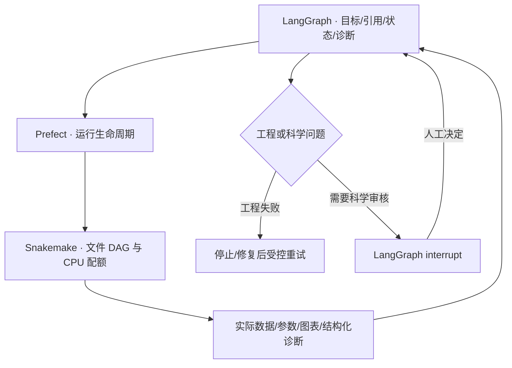

# LangGraph / Prefect / Snakemake 调度与上下文分发

## 分工与执行边界

前端每次上传一个新 ZIP 或多个新文件，不需要选择历史运行。LangGraph 管理请求 State、结构化诊断与人工 interrupt；LangGraph 调用 Prefect，后者管理运行生命周期，再调用 Snakemake 按文件依赖执行。真实安装版本为 LangGraph 1.2.11、langgraph-checkpoint-sqlite 3.1.1、Prefect 3.8.6、Snakemake 9.27.0。



最新十节点画布、EDA、充分性与临床外循环见 [WORKBENCH.md](WORKBENCH.md)。下文的来源拆表和已有 verified_replay 模型入口是兼容执行能力；并不意味着所有新画布节点都具备科学适配器。


控制层为 `graph_execution.py` 与 `graph_control.py`；`context_router.py` 继续负责已适配 PMB 数据的最小 context 分发。模型估计、规则计算与命令执行由确定性代码完成。LLM 用于 proposal 提取；数值估计仍是本地 Python/R。分发计划列出任务、文件及 SHA256、依赖、可并行任务和 CPU 配额。计划不能制造审核通过或补造数据。

**当前适配范围：**新上传流程已接入文件登记、proposal 模型调用、通用来源拆表，随后停在字段映射审核。通用拆表不代表科学清洗完成。任意新表仍需符合已有 data-preparation plan，经过 `/pipeline/v1/modules/data_preparation/run` 和 `/pipeline/v1/data-reviews` 完成科学 QC / 人工放行。前端尚未提供通用可视化字段映射编辑器。已核验 PMB 表的探索性 PK/index 重算作为独立 `verified_replay` 兼容入口，已迁入相同 Prefect/Snakemake 执行层；它不签署 B2 gate，不建立人体外推有效性。

## 上下文结构

B1 保持原 3.0 结构：`version / objective / study / data / rules / checks / uncertainties`，规则保留 R001 等编号。只把 proposal 内容送入压缩模型；模型调用不增加内容词数或输出长度上限，沿用原超时与一次调用失败即停策略。

B2 后的已适配分发器输出：

| 文件 | 内容 | 接收者 |
|---|---|---|
| `rat_population.json` | 大鼠定量记录、给药、元数据、来源证据、适用编号规则 | 群体 PK |
| `rat_individual.json` | 对应大鼠 PK 输入与逐只拟合任务 | 逐只 PK |
| `mouse_plasma.json` | 小鼠资料及描述性分析范围 | 小鼠 PK |
| `index.json` | 相关药效、暴露摘要、MIC、结合率、方案资料引用；指标与比较规则 | index |
| `literature.json` | 药物、模型目录引用与可靠性审查要求 | 文献模块 |
| `review.json` | 数据报告引用与审核范围 | 人工审核 |
| `routing_plan.json` | 分发理由、排除项与可并行任务 | 调度 / 审计 |

这些不是多个重复的全量 main.json。数值模块没有收到聊天历史或整份 proposal。当前规则编号分配针对已核验 PMB 3.0 上下文；新项目必须重新审核规则到模块的对应关系。Index 不把原始浓度当作 fAUC/MIC 等指标。文献 handoff 预留给既有文献 API，当前拟合流程不自动发起联网检索。

## 目录

```
research_pipeline/
  workflow/Snakefile
  workflow/rules/blocks.smk
  research_pipeline/orchestration.py     # Prefect flow / task
  research_pipeline/workflow_runtime.py  # 任务合同、执行收据、失败停止
  research_pipeline/context_router.py    # 最小上下文分发
outputs/workbench_state/workbench_jobs/<run>/
  request.json                          # 本轮输入引用
  plan.json                             # DAG 与 CPU 配额
  contracts/<block>.json                 # 每一步自己的输入/输出
  receipts/<block>.json                  # 成功输出及哈希
  attempts/<block>/<attempt>/            # 真实命令、PID、日志
  status.json                           # 业务状态与 Prefect run id
outputs/<run>/                          # 数据及模型产物
```

成功收据只在所有声明输出存在后生成。源文件、代码、合同或完成结果发生变化，旧运行的续跑会拒绝，需新建运行。技术失败后由用户明确发起续跑；已完成步骤由 Snakemake 跳过，失败步骤的部分文件保留在 attempt 目录。不会自动重试。来源/临床适用性缺口与程序异常分别记录。

Prefect 的 `Completed` 表示所请求的技术阶段执行完毕；科学状态以 `status.json` 的 `WAITING_FOR_HUMAN_REVIEW` 等字段为准。当前画布人工边界采用 LangGraph interrupt + SQLite checkpoint；各次计算有独立控制 trace。中断无需一直占有计算进程。恢复是恢复状态后继续图执行；计算暂停后未完成的文件块会重跑，不是从 R 的某一源码行续接。未配置自动周期任务。

## 本地 CPU

本机检测 16 个物理核心，默认给工作流 15 个计算配额。大鼠群体任务占 4 个，Windows PSOCK worker 并行计算独立初值和留一动物验证折；其他分支各 1 个。BLAS / OpenMP 每进程 1 线程，避免嵌套超额并行。候选排序、初始值、拟合方法和验证定义保持一致。

验证 R 脚本需要独占创建 `verification/`，因此回归测试安排在它之后；PK 与 index 仍可并行。单个模型的数值初值失败仍作为模型诊断记录，进程异常则停止整个任务链。

实测串行与并行结果及耗时见 `outputs/Workflow_Validation/cpu_benchmark.json`。此为同机一次对照，速度会受系统负载影响。

## 运行及 API

```powershell
.\.venv-context\Scripts\python.exe -I -m pip install -e './research_pipeline[workflow]'
.\research_pipeline\start-workbench.ps1
```

工作台： http://127.0.0.1:8767 。`新建运行` 上传本轮文件；`运行记录` 查看计划、block 状态和文件；左下连接设置查看 ChatGPT 登录状态并测试真实模型调用。

新运行：`POST /ui-api/jobs`

```json
{"upload_ids":["registered_upload_id"],"stop_after":"data_preparation","proposal_entry":null}
```

`stop_after` 可为 `intake`、`context`、`data_preparation`。`intake` 不调用模型。非画布作业可通过 `/ui-api/jobs/{id}/resume` 指定下一目标继续技术执行；画布作业必须经节点审核接口和暂停/继续接口管理；这不构成科学审批，也不能从新数据跳到拟合。

命令行调用同一入口：

```powershell
.\.venv-context\Scripts\python.exe -I -m research_pipeline.orchestration <request.json> --dry-run
.\.venv-context\Scripts\python.exe -I -m research_pipeline.orchestration <request.json>
```

默认使用本地 Prefect 临时服务，运行元数据存入项目 `outputs/prefect_local`。本机通信绕过外部 HTTP 代理。Snakemake 输出收据采用相对路径，避免 Windows 编码元数据文件名过长。未上传到 Prefect Cloud。

## 参考

- [Prefect flows](https://docs.prefect.io/v3/how-to-guides/workflows/write-and-run)
- [Snakemake workflow layout](https://snakemake.readthedocs.io/en/stable/snakefiles/deployment.html)
- [LangGraph interrupts](https://docs.langchain.com/oss/python/langgraph/interrupts)
- [LangGraph persistence](https://docs.langchain.com/oss/python/langgraph/persistence)
