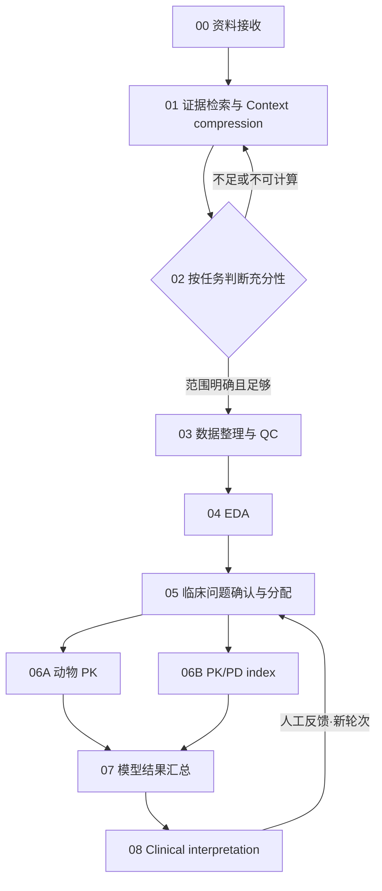

# 流程画布工作台 2.1

首页是空白框架，只读取流程定义。不会自动载入历史项目、上传资料、调用模型或启动 R。

## 当前预览与启动

本轮新版预览：http://127.0.0.1:8769/ 。使用独立的 `outputs/Workbench_Preview_v21/state` 与 `runs`；现有 8767/8768 服务未停止。

常规启动仍可在工作区运行 `research_pipeline/start-workbench.ps1 -Port <空闲端口>`，其默认端口为 8767。FastAPI 直接提供静态前端，不需要前端构建进程。

## 流程

每个正向交接都要求本步完成且人工审核通过。若 index 需要本轮 PK 生成暴露，增加 PK→index 依赖；已有匹配暴露时才允许两分支并行。

## 操作

- 点击节点查看「接收」「Context」「文件」「审核」；EDA 多一个「EDA 检查」，分配节点有「临床问题」，最后有「外循环」。
- 连接线是超链接，进入来源节点的交接文件说明。
- JSON 保存任务、规则和实际文件引用；CSV/XLSX、图表、模型与证据附件一起按需传递。
- 模板和计划文件与实际执行产物分开显示；模板下载名为 `*.template.json`。
- 「创建空白运行」后添加本轮文件。`/?flow=<id>` 可恢复指定会话；直接访问 `/` 始终为空白。
- 顶部显示累计运行时间，各节点显示本步时间和开始时间。等待人工审核与已暂停时间不计入；并行时间按时间区间合并，不重复求和。
- 「暂停运行」请求停止当前作业的计算进程树。停止被确认前显示“正在暂停”。继续时保留成功收据，未完成块从块起点重算；不保证 R 进程内的优化迭代续接。
- 分配前确认 12 项研究/临床定义：PD 终点、时间窗、实验单位、感染部位、目标人群、暴露、MIC/结合率、方案可行性、安全性、转化假设、判据等。未知用 UNKNOWN 加原因。
- Clinical interpretation 分别检查 regimen feasibility、safety 和临床相关性。反馈会建立保留原审核记录的空白新轮次，需要重新核验输入与审批。
- 最终接受后可生成本地报告审计 ZIP；不是向外部平台发表报告。

EDA 部分于 2026-10-09 整体移除，正在重建。侧栏「规则」中的 12 项通用审计标准全部未启用，待项目负责人审阅。

## 审核和完整性

后端要求完成状态、实际文件存在及版本一致、前置审核通过、审核人/明确确认；默认选择“通过”，通过时补充意见选填，要求修改或不通过时原因必填。审核以真实 LangGraph interrupt 暂停并持久化到 SQLite；版本变化会撤销旧审批和下游放行。客户端没有“标记完成”的接口。旧 `/jobs/{id}/resume` 不能续跑画布拥有的作业以绕过审核。

最终审计含输入、输出、规则快照、事件、人工决定、LangGraph checkpoint 历史、执行请求/合同/收据/日志。checkpoint 通过 LangGraph API 导出，不直接复制活动数据库。审核人由本地使用者填写，目前未接入独立身份认证。

## 接入范围：工程框架与科学执行分开

| 节点 | 当前状态 |
|---|---|
| 接收 | 可真实执行，交人工审核 |
| Context compression | 接入 proposal-only 提取，保留原 3.0 结构 |
| 充分性 | 定义合约和阻断逻辑，通用科学判定适配器待接入；无判据不能放行 |
| QC | 保留已有拆表/准备执行器；映射和科学清洗未完成时不能批准 |
| EDA | 已接入核对后的五组检查协议、输出合约和人工要求；任意新表的计算适配器待接入 |
| 分配、PK/index、汇总、临床解释 | 本轮画布合约/依赖/人工门控已定义；新数据科学适配器待接入 |

因此，此版空白画布会在缺少适配器的节点保持锁定。已有独立 Python/R 模型计算入口和 verified_replay 兼容流程仍保留，但不能替代新项目的 QC 或临床批准。工程测试通过不等于完整科研分析链路已经运行，更不证明人体外推可靠。

## API

共同前缀 `/ui-api/workflow`：

| 接口 | 用途 |
|---|---|
| GET /template | 空白节点与文件合约 |
| GET /eda-protocol | 已核对 EDA 图表与解释协议 |
| GET /rules-draft | 只读、未激活通用规则草案 |
| POST /sessions | 新会话 |
| GET /sessions/{id} | 状态、计时、文件引用、门控 |
| POST /sessions/{id}/files | 绑定本轮附件 ID |
| POST /sessions/{id}/pause 或 /continue | 暂停请求/确认后续跑 |
| POST /sessions/{id}/clinical-questions | 人工确认问题定义 |
| POST /sessions/{id}/nodes/{node}/start | 经门控启动 |
| POST /sessions/{id}/nodes/{node}/review | 与产物版本绑定的人工决定 |
| GET /sessions/{id}/nodes/{node}/artifacts/{name} | 实际文件 |
| POST /sessions/{id}/cycles | 临床反馈新轮次 |
| POST /sessions/{id}/publish | 最终接受后的本地报告审计包 |

附件上传为 `POST /pipeline/v1/attachments`。可选本地令牌由 `RESEARCH_PIPELINE_API_TOKEN` 和前端连接设置管理。

## 验证

详见 [WORKFLOW_VALIDATION.md](WORKFLOW_VALIDATION.md)。完整 Python 回归、真实三层调度测试、浏览器只读与合成文件执行测试分开记录，不签署真实研究结果。
