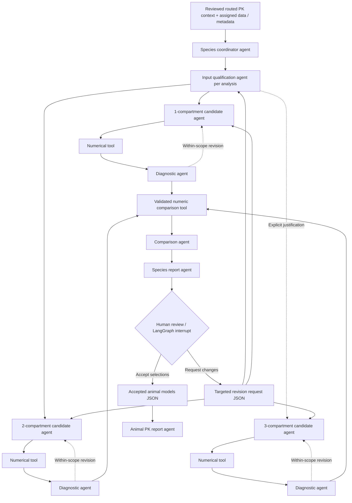

# Animal PK: species-first agent loops

## Scope and implementation status

This first strategy estimates animal PK within species. Joint multi-species fitting and human scaling are deferred. The existing routed PK context is the input; proposal compression and approved historical outputs are not repeated or modified.

**Connected now:** metadata-driven species planning; isolated logical-agent contracts; executable LangGraph candidate revision loop with injected numerical adapter; deterministic AIC/BIC comparison; SQLite-backed LangGraph human interrupts and candidate selections; JSON CLI interfaces; LangGraph → Prefect → Snakemake architecture runs; workflow UI preview and artifact downloads.

**Still pending:** qualification of the actual scientific fitting inputs, route/absorption/error/random-effects specifications and model-library permissions; production R/NONMEM or other numerical adapters; execution of the complete scientific agent graph from the UI. The main PK node therefore remains scientifically locked. Its architecture inspector can be opened before routing approval, and architecture checks never release a downstream model.

Architecture checks materialize requests and receipts with `llm_calls: 0`, `fit_calls: 0`, and `PLANNED_NOT_INVOKED`. Empty AIC/BIC cells mean no fit was performed. They are not simulated scientific results. Synthetic tests exercise injected LLM/fit adapters separately and are explicitly identified as fixtures.

## Graph

Every logical scientific step is an independent agent with a role, scoped input, rules and JSON output. A numerical solver is a tool used by an agent; it does not invent research conclusions. The human decision is made by a person. Each `invoke_agent` call starts a fresh provider request, uses no previous conversation, and saves request, response and execution evidence. An agent can receive only this step's relevant upstream results through the host's explicit `inputs` argument. This is scoped context assembly, not an OS-level file-access whitelist.

## Scope and source boundaries

Species come from validated metadata, with basic mouse/rat/rabbit aliases. One source table is initially one planning unit; this avoids silently pooling studies, dose groups, matrices, sampling designs or free/total concentrations. It does **not** declare every table independently sufficient for fitting. The species coordinator must propose a scientifically justified analysis grouping before fitting. The present interface deliberately keeps this unresolved instead of deciding it from filenames.

PK support files (dosing/binding) are listed as awaiting explicit association, not joined automatically. Human and held-out metadata are rejected from the animal development plan. A source hash or metadata/data identity mismatch blocks construction. Each candidate sees its own analysis data, metadata, scoped EDA findings and project task/rules. The comparison agent receives candidate reports and numerical comparison output, not the entire original document collection.

1C and 2C are candidate **structures**, not fixed IV equations. Route, absorption, estimator, error model and random effects remain required qualification fields. 3C is added by `options.three_compartment[analysis_id] = scientific_reason`; no data-size threshold is invented. Method rules remain project-reviewed; this addition does not enable the dormant generic PK/PD rule draft.

## Candidate loop and outputs

`animal_pk_agents.run_candidate(model_contract, diagnostic_contract, qualification_ref, folder, fit_adapter=..., generator=..., max_attempts=2)` is the executable extension point. The qualification includes candidate ID, compartment count, verified input refs, and an approval reference. The numerical adapter is trusted host code, never a command supplied by an LLM. It must validate the complete scientific input and parameter policy before execution. No production adapter is registered in this release.

The loop is `candidate agent → numerical tool → diagnostic agent → candidate revision / comparison / needs review`. Each attempt has separate files; previous diagnostics can be passed back as a targeted revision. The revision budget is explicit and configurable; it is unrelated to model timeout or token limits. Exhausting it requests review instead of looping indefinitely. A missing adapter produces `PK_FIT_ADAPTER_PENDING` before any model call.

Each successful numerical result must supply `candidate_id`, `species`, `analysis_id`, `status=FITTED`, `converged`, `log_likelihood`, `n_parameters`, `n_observations`, observation signature, response scale/unit, likelihood definition/constants, ML estimation method, BIC sample-size definition, numerical diagnostic status/rule signature, and verified execution/code/diagnostic file references.

The comparison tool calculates `AIC = -2 logLik + 2 k` and `BIC = -2 logLik + log(n) k`. Parameter count must include all estimated likelihood parameters. The adapter must explicitly justify `n` for its model and design; records are not silently relabeled as independent animals. Only eligible candidates with identical comparability contracts are ranked together. AIC and BIC recommendations are kept separately, including ties. No cross-species or cross-source AIC ranking is performed. A singleton gets no comparative winner. Approximate likelihood, REML and Bayesian comparisons need separately qualified adapters.

Method reference: [R stats AIC/BIC documentation](https://stat.ethz.ch/R-manual/R-devel/library/stats/html/AIC.html). This reference specifies numerical comparison conditions; the software workflow and review policy are project design choices.

## Human review and outer loop

`begin_review` starts a durable SQLite-backed LangGraph interrupt for a species comparison signature. `finish_review` checks that signature, selected candidates and artifact hashes before resuming it. Approval permits an empty rationale and writes `accepted_models.json`; it never validates human prediction. Request changes requires a target agent role and concrete changes, writing `revision_request.json`. Actual rescheduling after that handoff awaits the production scientific execution integration; old attempts remain intact. A rejected candidate cannot silently be promoted by the report agent.

## Interfaces

UI entry: **Animal PK → Open animal PK architecture**. Inspect each agent, optionally justify 3C, download the plan, or run architecture checks. Run status, elapsed time, pause and artifact links appear in the inspector.

HTTP prefix `/ui-api/workflow`:

- `GET /animal-pk/blueprint`
- `GET /sessions/{id}/animal-pk/plan`
- `POST /sessions/{id}/animal-pk/architecture-runs` with `{"three_compartment": {"analysis_id": "reason"}}`
- `GET /sessions/{id}/animal-pk/architecture-runs/{job_id}`
- `POST /sessions/{id}/animal-pk/architecture-runs/{job_id}/pause`
- `GET /sessions/{id}/animal-pk/architecture-runs/{job_id}/files/{name}`

CLI JSON handoffs: `python -I -X utf8 -m research_pipeline.animal_pk_cli ACTION request.json --out OUTPUT`.

- `plan`: `{"pk_context":{"path":"...","sha256":"..."},"options":{}}` → `architecture.json`.
- `compare`: `{"fit_results":[{"path":"...","sha256":"..."}]}` → `comparison.json`.
- `begin-review`: `{"comparison":{"path":"...","sha256":"..."},"session_id":"...","species":"mouse"}` → review interrupt.
- `review`: human decision JSON with `decision`, `reviewer`, `confirmed:true`, `output_signature`, and `selected_candidates` for approval; or `return_to`, `requested_changes`, optional `candidate_ids` for revision → decision plus accepted models or revision handoff.

No per-species acceptance is inferred from the architecture run finishing. Actual human review and numerical evidence remain required.
