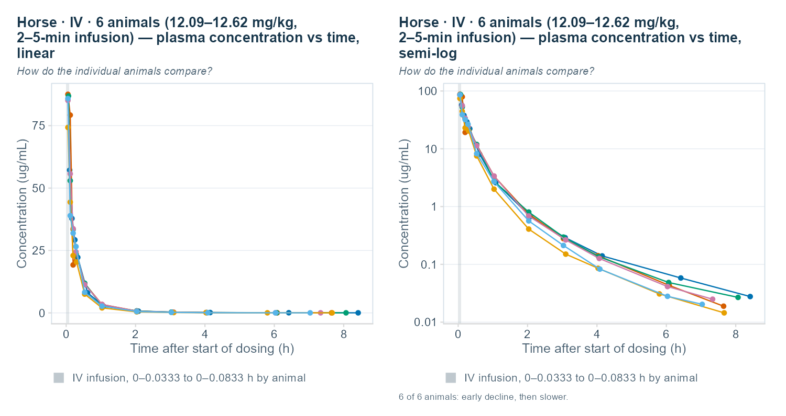

# DBG01 · Single intravenous dose in horses

[Download the complete report](DBG01-report.zip?raw=true) and open `index.html` after extracting it. The gallery contains 19 figures.

Six horses received one short IV administration each. The mapped input contains 11 plasma concentrations per animal, with dose in mg/kg, time in hours and concentration in µg/mL. Absorption has no applicable extravascular profile.

**What to review.** The six IV curves show a steep early decline followed by a slower decline. The rule-defined late interval start was located in one of six profiles. Review the observed-window AUC and the supported late points in each animal. One- and two-compartment models remain candidates for fitting to the same IV observations.

**Evidence limits.** There is one route, one dose level and one species. The data do not identify dose dependence or removal pathways. No urine, bile, binding or metabolite measurements are available.

[Review checklist and active rules](../README.md)
