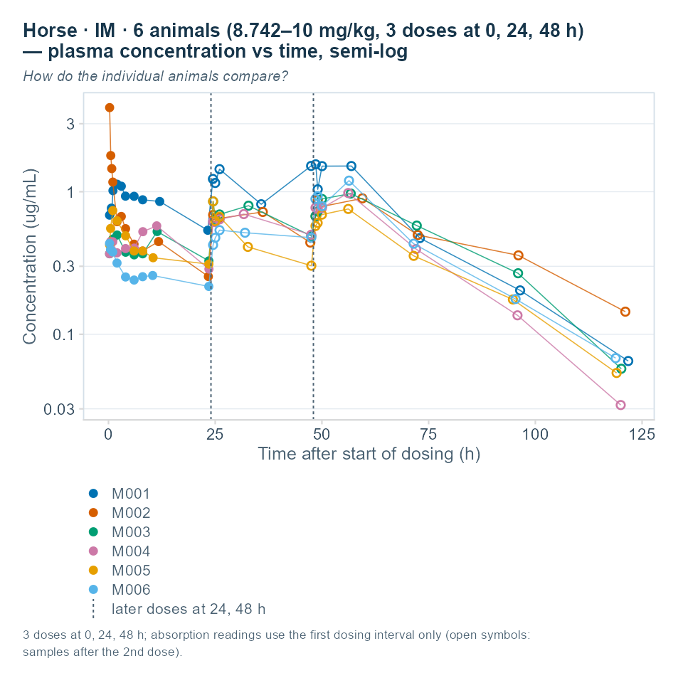

# DBG03 · Repeated intramuscular and single intravenous dosing in horses

[Download the complete report](DBG03-report.zip?raw=true) and open `index.html` after extracting it. The gallery contains 53 figures.

The same six horses have two occasions. Three IM doses were given about 24 hours apart, with 130 plasma samples. A separate short IV administration provided 66 samples. The input identifies the animals across routes. The interval between occasions and the period order are unavailable.

**What to review.** The absorption shape analysis uses the first IM dose interval. The modeling facts report a separate apparent terminal half-life after the last dose. Check the sampling windows before comparing the two readings. The paired, dose-normalized exposure ratio is descriptive. The median is about 1.09, with one animal at about 1.82. This comparison does not establish absolute bioavailability.

**Evidence limits.** A slower apparent decline after IM administration motivates testing absorption-limited decline. Sampling density, comparable disposition across the two occasions, and the model used for input still affect that interpretation. There is one dose level per route and no urine, bile, binding or metabolite measurements.

[Review checklist and active rules](../README.md)
